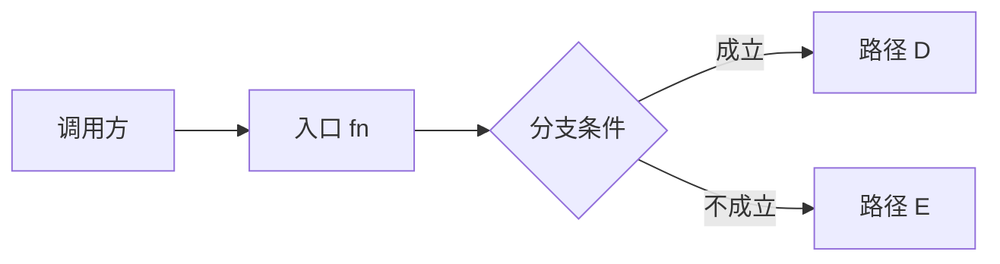

# explain-code — 把代码讲直白

对象：一个函数 / 一个模块 / 一段逻辑 / 一次改动 / 一个仓库。目标：按用户的具体疑问讲明白它**做什么、怎么做、为什么这么做**，并且能顺着 `file:line` 回原文核对。

深入讲解时读 `../commons/plain-craft.md` 的三层结构与六条铁律；窄问直接回答，无需为套骨架读取 craft。本条只给代码场景的具体骨架。

已贴代码直接作为一手材料；无源文件时，本篇的 `file:line` 使用 `用户片段:行号`（从所贴代码第一行计数），讲解范围限于片段能支持的行为。不为独立片段索要或虚构文件、调用方与仓库版本；仅在缺失上下文影响解释时追问。

实现暂不可得而用户只求初步理解时，可据可回查文档解释其声称的预期行为，明确尚未核对实现；不能把文档描述说成当前源码或真实运行结果。

窄问题（如“第 18 行为什么返回 null”）先直接回答该行、必要上下文与一个例子；只有用户要整体流程或该问题离不开全局结构时才使用以下骨架。

## 深入讲解骨架

### 1. 范围与锚

- 一句话：**这段代码解决什么问题、给谁用**（不含实现术语）
- 调用关系复杂时加一张对话内的 ASCII / Mermaid 简图，标出入口；不因这张辅助图启动独立 HTML 制图流程



### 2. 数据形状

先讲**数据**，再讲**流程**——流程难懂往往是数据结构没交代清楚。

| 数据结构 | 形态（字段/含义） | 生命周期（谁创建/谁修改/谁消费） |
|----------|-------------------|-----------------------------------|
| `<结构名>` | `<关键字段 + 人话含义>` | `<file:line → file:line>` |

### 3. 走一遍（流程讲解的核心）

拿一个**具体的最小输入**，沿所讲的关键路径完整走一遍，不为“完整”遍历无关文件。每步标 `file:line`；有真实运行记录时写实测取值，否则注明示例输入及必要假设，写条件推演出的值，不称为某次真实运行。时间、随机、网络、并发等非确定性结果尤其如此。

```
示例输入: <具体值>；假设: <必要的外部条件，若无则省略>
① fn() 进入                     src/x.c:120    state = {…}
② 命中分支 cond                  src/x.c:133    走左边
③ 写入 buffer                    src/x.c:141    buffer = [...]
④ 返回                           src/x.c:150    结果 = <具体值>
```

要求：可控输入和可推得的数字写**具体数字**；无法从输入与代码确定的值，列出假设或分支条件。`file:line` 用于核对控制流和赋值规则；具体取值还须由输入、假设或运行记录支撑。

**改动 / diff**：核对改前、改后材料，按**旧行为 → 新行为 → 差异的触发条件 → 影响范围（必要时核对调用方）→ 两侧出处**讲；旧版或相关调用方不可得就标明证据边界。当前代码的“走一遍”不能代替前后对照；窄问只答相关差异。

### 4. 关键机制

只讲支撑行为的关键点，逐条：**代码已证明的行为 → 已说明的设计理由或标明的推断 → 有依据的代价或边界**。用户追问设计缘由时，先查可用的设计文档、注释和提交历史；有明确记载才转述并标出处。查不到就写「原因未知」，再把由实现推得的权衡标为「推断」，写明依据和可能的其他解释，不归于作者。

- 与直觉冲突的地方要显式点名（"这里容易以为是 X，其实是 Y，因为……"）

### 5. 反例与边界

- 什么输入会走到另一条路径 / 触发错误 / 什么看起来相关但不影响结果
- 边界情况（空、极值、并发、错误注入）

### 6. 术语表与按需自测

- 术语表：`<术语> — <人话解释> — <首次出现位置>`
- 普通练习可给少量边界或"若改成 X 会怎样"的问题及答案/判据，不问复述；用户要检验理解时先只出题、等作答，再逐题判断、指出误解并针对性纠正，未作答不称检验完成

## 代码场景专属规则

| 规则 | 说明 |
|------|------|
| 读实现，不读命名 | 禁止凭函数名/注释猜测行为；命名与行为不符时以代码为准并指出 |
| 理由分级 | 代码证明行为；追问缘由先查可用的设计文档、注释和提交历史，未查到明示理由则写「原因未知」；实现推论标「推断」及依据，不当作作者意图 |
| 追踪调用方 | 有仓库上下文且调用关系会影响当前行为或范围结论时，核对相关调用方；只讲当前模块机制时不机械追踪。未查时不暗示已核验调用范围；独立片段仅在缺失上下文影响解释时追问 |
| 版本锚定 | 版本差异会影响结论或用户要求版本/改动对照时，核实所比较的具体来源：Git 仓库锚定固定 commit hash，branch 仅作辅助；发行包或归档核对版本号与包/归档身份，能取得哈希时记下。包与 commit 的对应关系无法核实时说明，不凭空补 commit。只讲当前模块机制时不机械查询或输出版本。引用未提交改动的 `file:line` 时说明行号指向工作区、所报 commit 只是基线；未核实版本不暗示已核实，独立片段不虚构版本 |
| 剔除噪声 | import、格式调整、生成代码（`.pb.*`）不占篇幅，除非影响理解 |
| 大文件先给地图 | 讲整体结构或深入讲解且文件超过一屏时，先给简短的"文件/函数地图"，再下沉到用户关心处；窄问直接答卡点，不因文件大先铺地图 |

### 跨文件关系的同状态核验（按需）

只有调用链、注册/处理映射等结论**依赖多个文件来自同一源码状态**时，才列出支撑该关系的相关文件和行段，并选一种方式核验：

- 取得共同的不可变版本标识，并确认实际读取的各文件内容都属于该版本；工作区有未提交改动时，仅有 `HEAD` 不够。
- 使用真正冻结全部相关文件及所需发现范围的可访问快照，从快照读取并逐文件核对摘要；先后逐文件复制本身不算冻结。
- 对活跃工作区，确认并记录无并发写入的稳定窗口，在读取行段前后分别核对同一完整相关文件集合的路径、字节数和 SHA-256，要求两次清单与摘要完全相同；有并发写入时，双遍摘要不能证明同一状态。

仅当跨文件关系实际依赖运行时文件发现、目录扫描或插件发现时，把发现结果也纳入同状态证据：记录发现根、扫描与匹配规则，以及相应目录条目或匹配路径集合。不可变版本须覆盖实际参与发现的目录树；使用冻结快照或稳定窗口时，在读取相关文件前后按相同规则重新枚举该范围，并连同全部命中文件及其他支撑关系文件的字节数和 SHA-256 核对。新增、删除、改名或内容变化导致不一致；只核对已知文件的摘要不足以证明发现集合未变。有限扫描只能支持所查范围内的关系，不能称为全工程证明。

若发现结果还取决于配置、生成步骤、环境变量或运行时插件注册，记录实际影响发现的输入和版本，并与上述源码/目录状态一起复核；敏感值仅在受限取证中核对，不在答复泄露。无法固定或复核这些输入时，只说明已观察到的路径集合，不把它推广成同状态下完整的运行时发现关系。

无法覆盖所需发现范围或证明所需一致性，就把“这些文件在同一状态中构成当前关系”标为「未核验」，不把不同版本拼作事实；仍可分别解释已读文件中的静态规则与关系成立的条件。普通单文件窄问和不依赖同一状态的结论不触发这套核验。

## 交付状态（按需）

窄问直接作答；深入讲解或文件交付时，按需简述实际产物、所读出处、未核验范围和与本次问题相关的后续下钻方向，不逐项打印模板。
